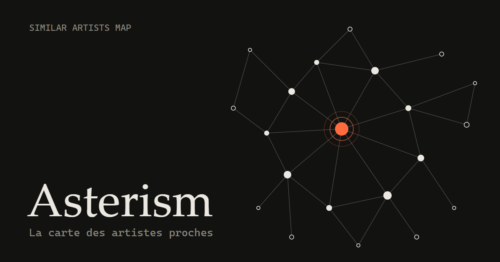

# Asterism

Asterism est une carte interactive des artistes proches les uns des autres, dans l'esprit de l'ancien TuneGlue Music Map. On cherche un artiste, on ouvre sa fiche, et on explore le graphe de proche en proche. Les données viennent d'API publiques, sans clé : Deezer d'abord, complété par iTunes, MusicBrainz, ListenBrainz et Wikidata.

Un astérisme est une figure d'étoiles reconnaissable, comme la Grande Ourse. C'est ce que dessinent des artistes reliés entre eux, et c'est aussi le nom du signe typographique ⁂ qui a inspiré le logo.

Pas de build, pas de serveur, pas de clé d'API : tout se passe dans le navigateur. On peut ouvrir `index.html` directement depuis le disque.

## Fonctions

- **Recherche** d'un artiste, ou bouton **Surprends-moi** (recherche au hasard, puis un saut vers un voisin pour tomber sur un artiste bien relié).
- **Fiche** au clic sur un nœud : Explorer, Écouter, Top des titres ouvert par défaut (3 à 10, réglable). La barre de lecture se déplace dans l'extrait de 30 secondes.
- **Lecteur** : un encart séparé, en bas à droite (sous la recherche sur téléphone), visible pendant toute la lecture. Photo cliquable pour rouvrir la fiche, lecture et pause, temps, barre de progression. La musique continue quand on ferme la fiche ou qu'on regarde un autre artiste (seule l'écoute au survol s'arrête).
- **Écouter ses voisins** : depuis la fiche ou le menu, l'artiste puis ses voisins, du plus compatible au moins compatible, un extrait chacun, pilotée depuis l'encart du lecteur (précédent, suivant, arrêter, position 3/21). Choisir un artiste à la main arrête l'écoute.
- **Discographie** : albums, EP et singles Deezer avec pochette et année, un clic joue le premier extrait de l'album. Deezer mélange parfois des homonymes sous un même artiste et ajoute ses featurings : les sorties d'un genre éloigné du genre dominant, quand elles forment un vrai groupe, sont repliées sous « + N sorties d'un autre genre ».
- **Mes écoutes** : marquer un artiste « À écouter », « Aimé » ou « Écouté ». Un anneau entoure sa photo sur la carte (plein orange pour Aimé, tirets orange pour À écouter, pointillé fin pour Écouté), avec une légende et un filtre « Tout, Aimés, À écouter, Écoutés » dans les réglages (groupe Affichage) qui estompe les autres artistes. Le bouton « Mes écoutes », à côté de « Surprends-moi », affiche leur nombre et ouvre la liste : filtre par état, changement d'état, retrait, ouverture de l'artiste sur la carte, export en fichier texte avec les liens Deezer. Tout reste dans le navigateur.
- **Repli Apple** : quand Deezer n'a aucun extrait, ceux d'Apple (iTunes) prennent le relais, avec un appariement strict sur le nom.
- **Ouvrir ailleurs** : logos Deezer, Spotify, Apple Music, YouTube Music, Bandcamp et SoundCloud. Lien exact quand Wikidata connaît l'artiste (souligné en orange), sinon recherche sur le nom.
- **Identité et liens (Wikidata)** : genres, pays, dates, site officiel, Instagram, Discogs, Wikipédia, pour les artistes qui ont une fiche Wikidata.
- **Score de compatibilité** de chaque lien, avec ses preuves source par source (au survol d'un lien et dans la fiche).
- **Radio Deezer et collaborations** : toujours actives, elles complètent les artistes similaires à chaque exploration. Chaque type de lien a sa case dans la légende du groupe Sources.
- **Sources étendues** (option expérimentale, décochée par défaut) : en plus de la radio et des collaborations, artistes du même label, voisins ListenBrainz, relations MusicBrainz (même artiste ou groupe). Les styles Discogs (Freetekno, Tribal, House...) de l'artiste et de ses voisins ajustent le score : des styles proches le renforcent, des styles sans rapport le réduisent. Les styles de l'artiste sélectionné s'affichent dans sa fiche. Un panneau montre l'avancement de chaque source, et les nouveaux artistes arrivent tous ensemble. Quand Deezer propose peu de voisins, la fiche invite à les essayer.
- **Réglages** en quatre groupes : Affichage (focus, distance, score minimal, petits artistes), Écoute, Sources, Carte.
- **Petits artistes** : estompe les artistes au-delà d'un nombre de fans, pour faire ressortir les petits.
- **Partage** : un lien qui contient toute la carte, ou une image PNG.
- **Menu contextuel**, **annuler et rétablir**, **écoute au survol** (option), **mode clair ou sombre**, **français ou anglais (selon la langue du navigateur : français si elle est française, anglais sinon ; le bouton FR / EN mémorise ton choix)**, aide intégrée (bouton `?`).

## Raccourcis

| Action | Souris | Clavier | Tactile |
| --- | --- | --- | --- |
| Ouvrir la fiche | clic | | tap |
| Explorer un artiste | double-clic | Entrée | double-tap |
| Menu de l'artiste | clic droit | | appui long |
| Passer à l'artiste voisin | | flèches | |
| Chercher un artiste | | `/` | |
| Zoomer, dézoomer | molette, boutons + et − | `+`, `-` | pincement |
| Supprimer l'artiste sélectionné | | Suppr | |
| Annuler, rétablir | | Ctrl+Z, Ctrl+Y | |
| Fermer l'aide, puis la fiche | | Échap | |
| Afficher l'aide | bouton `?` | `?` | bouton `?` |

L'adresse de la page mémorise l'artiste de départ : `.../#Radiohead` ouvre directement la carte de Radiohead. Un lien de partage commence par `#s=` et contient la carte entière.

## Fichiers

| Fichier | Rôle |
| --- | --- |
| `index.html` | Structure de la page et balises de référencement, puis chargement des scripts. |
| `style.css` | Tous les styles (variables de thème, bureau, puis mobile). |
| `js/core.js` | Base : débogage, cache local, API Deezer, état du graphe, simulation, types de liens et score. |
| `js/sources.js` | Sources étendues et panneau de progression. |
| `js/render.js` | Dessin du graphe sur le canevas et interactions (zoom, glisser, survol). |
| `js/actions.js` | Menu contextuel, historique, partage par lien et image. |
| `js/card.js` | Fiche de l'artiste : écoute, top des titres, repli Apple, Wikidata, logos. |
| `js/ui.js` | Recherche, réglages, bulles de retour, zoom, aide, clavier, thème. |
| `js/i18n.js` | Dictionnaire anglais, traduction du HTML statique, bascule de langue. |
| `js/boot.js` | Démarrage. |
| `og.png` | Image d'aperçu pour le partage (1200 x 630), sans photo d'artiste. |
| `logo.svg` | Le logo seul, qui s'adapte au mode clair ou sombre. |
| `sitemap.xml` | Plan du site, à déclarer dans la Search Console. |
| `.nojekyll` | Désactive le traitement Jekyll de GitHub Pages, inutile ici. |

**Numéro de version** : `index.html` charge `style.css` et les scripts avec `?v=AAAAMMJJx`. GitHub Pages autorise 10 minutes de cache : sans changer ce numéro à chaque publication, un visiteur peut recevoir le nouveau `index.html` avec d'anciens scripts. Changer les neuf occurrences d'un coup (même valeur partout).

Les scripts sont des scripts classiques, pas des modules : ils partagent la portée globale et sont chargés dans l'ordre ci-dessus. C'est ce qui permet d'ouvrir `index.html` depuis le disque (les modules y sont bloqués par le navigateur). Conséquence : un fichier ne doit pas appeler, au chargement, une fonction définie dans un fichier suivant. Les appels faits plus tard (clics, minuteries) ne posent pas de problème.

## Développer

- **Mode débogage** : ajouter `?debug=1` à l'adresse (ou mettre `mg-debug` à `1` dans le stockage local). Les erreurs volontairement ignorées (source indisponible, stockage refusé, lien de partage illisible) sont alors écrites dans la console.
- **Traductions** : tout texte affiché passe par `T('texte français', { valeurs })` et doit avoir son entrée dans le dictionnaire `EN` de `js/i18n.js`. Le HTML statique est traduit automatiquement s'il a une entrée.
- **Tester en local** : ouvrir `index.html` directement, ou servir le dossier (`python -m http.server`) pour tester sur téléphone.

## Publier sur GitHub Pages

La page est statique, il suffit de la servir telle quelle : **Settings > Pages > Build and deployment**, source **Deploy from a branch**, branche `main`, dossier `/ (root)`. Chaque push sur `main` met le site à jour en une ou deux minutes.

Si le compte ou le nom du dépôt changent, il faut mettre à jour l'adresse à quatre endroits : la balise `canonical`, les balises Open Graph et Twitter, les données structurées de `index.html`, et `sitemap.xml`. L'adresse de base des liens de partage ouverts depuis le disque est aussi dans `js/actions.js` (`SHARE_BASE`).

## Référencement

Ce qui est en place :

- Titre, description, adresse canonique, balises Open Graph et Twitter, données structurées `WebApplication`, couleur de thème claire et sombre.
- Un texte réel dans l'écran d'accueil, visible par tous les visiteurs, avec un seul `h1`.
- Une image de partage et un plan du site.

À faire, plutôt avec un nom de domaine :

1. Vérifier le site dans la [Google Search Console](https://search.google.com/search-console), puis y déclarer `sitemap.xml`.
2. Faire de même dans les outils pour webmasters de Bing.
3. Obtenir quelques liens entrants : c'est ce qui compte le plus pour un petit outil de niche.

Limites : un `robots.txt` placé dans ce dépôt serait ignoré (les robots ne le cherchent qu'à la racine du domaine `github.io`), et les adresses du type `#Radiohead` ne sont pas indexées, car Google ignore ce qui suit le `#`.

## Notes techniques

- **Deezer** : appels en JSONP (`output=jsonp`), car l'API ne renvoie pas d'en-têtes CORS. Environ 50 requêtes toutes les 5 secondes par adresse IP ; les sources étendues sont cadencées et réessayées en cas de quota dépassé. Le mode JSONP n'est pas garanti dans la durée.
- **Apple (iTunes Search)** : sans clé. Si `fetch` est refusé par le navigateur ou le réseau, un second essai passe par une balise script (JSONP, sans le paramètre `output=jsonp` que l'API refuse).
- **Discogs** : sans clé, environ 25 requêtes par minute et par visiteur ; file cadencée à une requête toutes les 2,6 s, réponses en cache 30 jours.
- **MusicBrainz** : une requête toutes les 1,3 seconde au plus, réessais en cas de 503. **ListenBrainz**, **Wikidata** : sans clé, CORS ouvert.
- **Liens de partage** : toutes les valeurs sont vérifiées avant usage (identifiants entiers, empreintes d'image, types de liens, preuves), car un lien peut venir de n'importe qui.
- **Stockage local** : réglages (`mg-theme`, `mg-lang`, `mg-hover`, `mg-ext`, `mg-kinds`, `mg-min`, `mg-top`, `mg-fan`, `mg-hint`, `mg-markf`), mes écoutes (`mg-marks`) et cache `mg-cache` (fiche Wikidata 7 jours, identifiant MusicBrainz et styles Discogs 30 jours, 600 entrées au plus).
- **d3** : chargé depuis jsDelivr en version figée (`d3@7.9.0`).
- **Logos** : icônes monochromes Simple Icons (CC0), intégrées dans `js/card.js`. Les marques appartiennent à leurs propriétaires.
- **Typographie** : piles de polices système. Aucune police externe n'est chargée.

## Mentions

Projet indépendant, sans lien avec Deezer, Apple, Spotify ni les autres services cités. Les noms, images et extraits audio appartiennent à leurs ayants droit. Les données Wikidata sont sous licence CC0 ; Wikipédia n'est cité que par des liens. Vérifier les conditions d'utilisation de chaque API avant tout usage au-delà d'une démonstration personnelle.

Licence : à choisir par l'auteur du dépôt.
